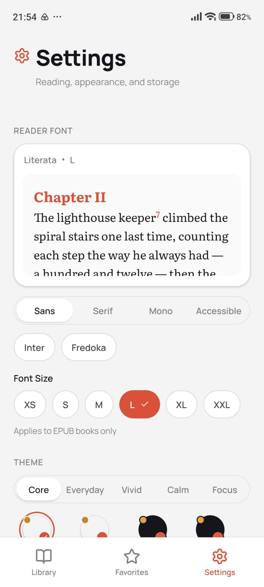
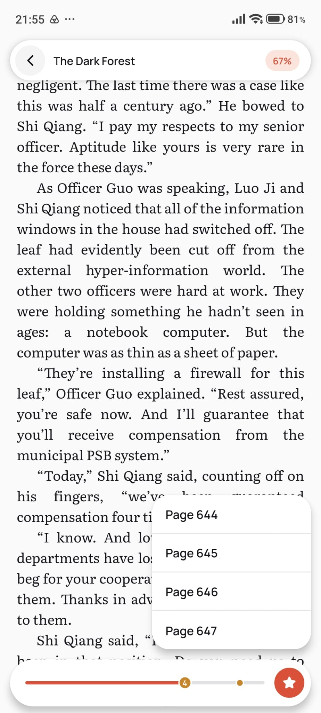

# Arcanum

**One Android reader for every ebook, document and comic you own.**
EPUB, MOBI/AZW3, PDF, CBZ/CBR and 15 file types in total, with a custom pagination engine, 23 themes and full control over how text looks.

`Public beta` · `Android` · `Built with React Native`

  
  
  
  

  
  
  

## Why Arcanum

- **Everything in one place.** Ebooks, PDFs, plain text, HTML and comics open in the same app with the same controls.
- **Pages the way the publisher designed them.** The pagination engine follows each book's own CSS, so chapter starts, images and page breaks stay intact.
- **You never lose your place.** Arcanum remembers the exact line you stopped on and returns to it, even after you change font size or rotate the phone.
- **Made to be adjusted.** Themes, fonts, text size, page-turn style, reading direction and a warm night filter are all one tap away.

## Download

Arcanum is in public beta. Grab the APK from the [Releases page](../../releases/tag/Release).

1. Download the `.apk` file on your Android phone.
2. Open it and allow installs from your browser or file manager when Android asks.
3. Open Arcanum and add a book.

Because the beta is distributed outside the Play Store, Android may show an "unknown source" prompt the first time.

## Supported formats

| Type | Formats |
|---|---|
| Ebooks | EPUB, MOBI, AZW, AZW3, PRC, FB2 |
| Documents | PDF, TXT, HTML, HTM, HTMLZ |
| Comics | CBZ, CBR |
| Archives | ZIP, RAR |

MOBI files that bundle both the old and the new (KF8) layout are handled too, so publisher styling and centering come through.

## Reading

- **Paginated or scrolling.** Choose a page-turn style that suits the book.
- **Left-to-right or right-to-left.** Read Arabic and other right-to-left material in the right direction; the reader toolbar mirrors itself to match.
- **Exact position memory.** Your place is stored as a character offset, not a rough percentage, and is re-anchored after rotation or text changes.
- **Table of contents, footnotes and internal links** that work across formats, including MOBI, with a back button that returns you to where you were.
- **Bookmarks on the progress bar.** Drag to seek with a live tooltip. Bookmarks that sit close together merge into one marker so the bar stays readable.
- **Tap to hide the toolbar** and let the page fill the screen.
- **Keep screen awake** while you read, even without touching the screen.
- **Warm night filter** adds a warm tint over the page for easier night reading.

## Appearance

- **23 themes in four groups** with a live swatch grid. Pages can be dark or light with contrasting text, and the "cross" themes Eclipse and Lantern pair a light app with a dark page or a dark app with a light page.
- **Playful themes** such as Retro Arcade, Citrus Pop, Grape Soda and Mango Tango.
- **Reader fonts in categories**, from comfortable everyday faces to fun ones, with a live preview card that shows your chosen font and size before you read.
- **Font size scale** from small to large, with a size label on the preview.
- **App font** setting for menus, titles and buttons, previewed live.
- **Themed dialogs** instead of stock Android alerts.

## Library and storage

- **Sort by** recently added, recently read, title or author, and set your default order.
- **Storage overview** showing space used by books and covers.
- **Cache control per format.** Extracted comic pages (capped at 800 MB), MOBI/AZW3 content (500 MB) and EPUB content (700 MB) trim themselves automatically, and each can be cleared with one tap behind a confirmation.
- **"Open with" support:** tap an ebook file in any Android file manager and it opens in Arcanum.
- **Smooth cover transition** from your library into the reader, with a floating, pill-shaped toolbar.

## Feedback

Bug reports and format requests are welcome: open an [issue](../../issues) and include the book format and what happened.

## About the project

Arcanum is a solo project, designed and built end to end by [Ulaş Şahin](https://github.com/ulassahin-ist), an independent developer in Istanbul. The source is private, and I'm happy to walk through the code and architecture on request. This repository hosts releases, screenshots and issue tracking.
