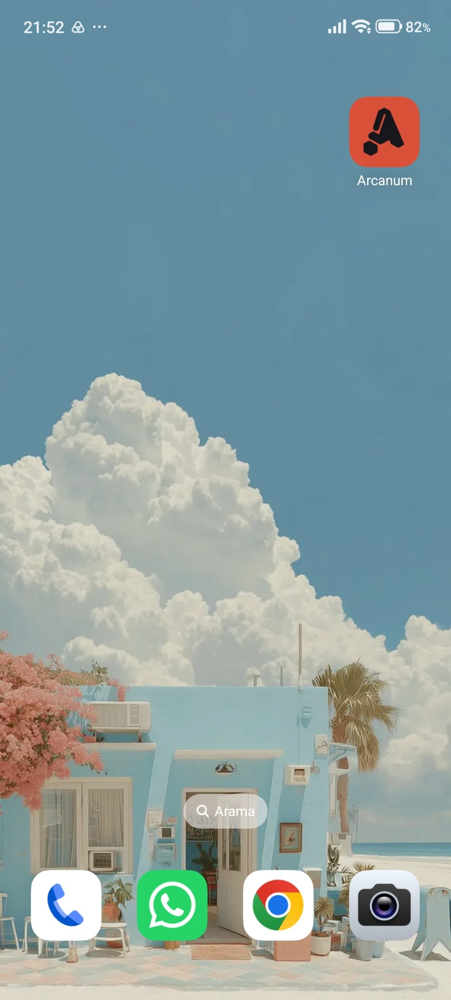
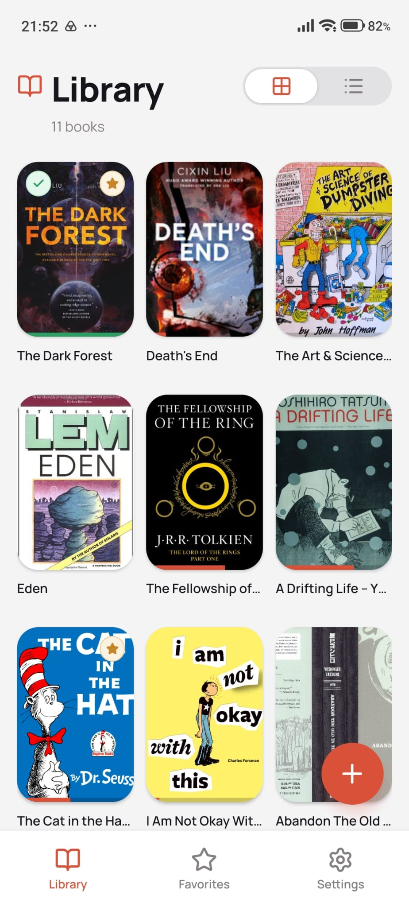
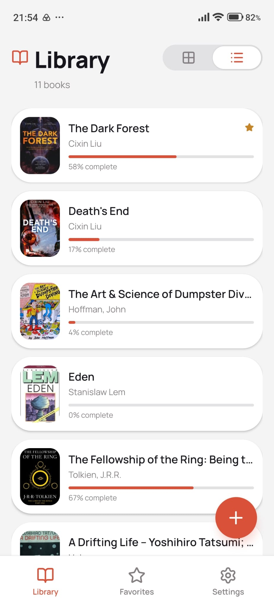
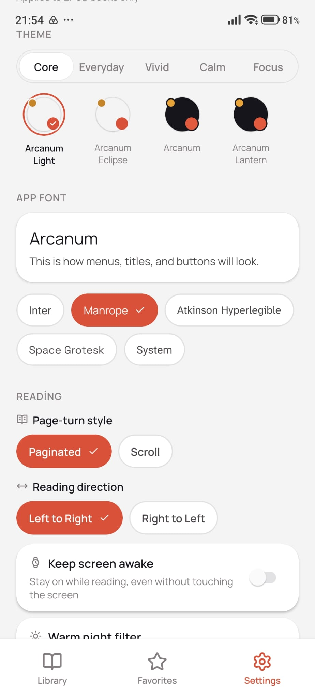

# Arcanum

**A fast, themeable ebook and comic reader for Android.**

Arcanum opens the formats you already have, paginates them with a custom reading engine, and keeps the interface out of your way.

  
  
  
  

  
  
  

## Download

Get the APK from the [Releases page](../../releases/tag/Release).

1. Download the `.apk` file on your Android phone.
2. Open it and allow installs from your browser or file manager when Android asks.
3. Open Arcanum and add a book.

Arcanum is not on the Play Store yet, so Android may show an "unknown source" prompt.

## Supported formats

| Type | Formats |
|---|---|
| Ebooks | EPUB, MOBI, AZW, AZW3, PRC, FB2 |
| Documents | PDF, TXT, HTML, HTM, HTMLZ |
| Comics | CBZ, CBR |
| Archives | ZIP, RAR |

## Features

- **Custom pagination engine** that follows each book's own CSS, so page breaks, images and chapter starts look the way the publisher intended.
- **Adjustable font size and font type**, for comfortable long reading sessions.
- **Many themes** to match your lighting and taste.
- **In-book navigation** with table of contents, footnotes and a back button that returns you to where you were.
- **Bookmarks on the progress bar**, with drag-to-seek.
- **Smooth cover transition** between your library and the reader, and a floating, pill-shaped reader toolbar.
- **"Open with" support**: tap an ebook file in any Android file manager and it opens in Arcanum.

## Status

Arcanum is in active development and not yet published to app stores. Bug reports and format requests are welcome: open an [issue](../../issues) and include the book format and what happened.

## Source code

Arcanum is closed source. This repository hosts releases, screenshots and issue tracking only.

## Author

Built by [Ulaş Şahin](https://github.com/ulassahin-ist), an independent developer in Istanbul.
